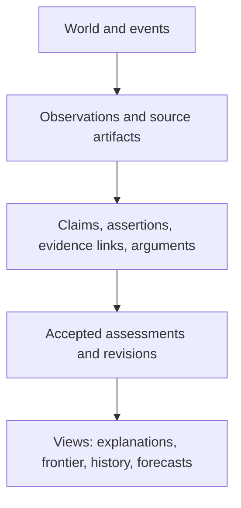
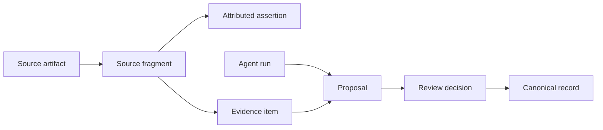
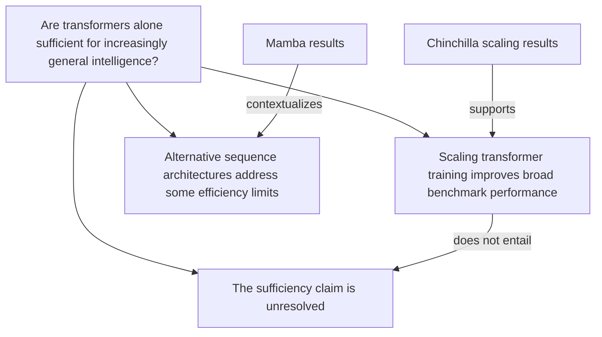

# Epistemic model

This document defines Noemosyne's normative vocabulary. Storage and API designs must preserve these distinctions even when the UI uses simpler labels.

## Design rule

Noemosyne does not store “truth.” It stores inspectable epistemic acts and artifacts: propositions, assertions, observations, evidence judgments, arguments, assessments, challenges, and revisions—each attributed, contextualized, and time-qualified.

## Four layers

The layers must not collapse. A source report is not the event; an observation is not an interpretation; an evidence link is not an assessment; an assessment is not the proposition itself.

## Core primitives

### Entity

Something referenced by epistemic objects: a model, lab, benchmark, dataset, paper, method, person, organization, task, hardware system, or concept. Entities have aliases and external identifiers, but entity identity is separately reviewable from claim identity.

### Claim

A stable identity for a truth-apt, scope-qualified proposition that may be supported, challenged, accepted, rejected, or left unresolved.

A claim contains:

- canonical wording;
- claim form;
- structured scope and conditions;
- temporal applicability;
- referenced entities;
- normalization status;
- immutable wording versions.

Example:

> On the mathematical reasoning tasks evaluated by Snell et al. (2024), adaptively allocated inference-time compute improved efficiency relative to best-of-N sampling.

This is preferable to “inference-time compute works,” because the source, task class, comparator, metric, and date matter.

### Assertion

An actor's attributed stance toward a claim at a time. A source author, human curator, model, agent, or organization may assert, deny, question, or withhold judgment on a claim.

Claim identity answers **what proposition?** Assertion answers **who presented which stance, where, and when?** Multiple sources can assert the same claim without creating duplicate claims.

### SourceArtifact

An externally identifiable artifact: paper, dataset, model card, benchmark page, repository release, report, web page, transcript, or structured record. It has bibliographic metadata, access and license metadata, a content hash where bytes are available, and one or more immutable versions.

### SourceFragment

The smallest addressable source span sufficient to evaluate an attributed assertion or evidence link. It may be a paragraph, table cell, figure region, benchmark row, code/result artifact, or timestamped transcript span.

A fragment stores a stable locator and hash. Text is stored only when licensing permits. A citation to an entire paper is insufficient when a more exact locator is available.

### ObservationRecord

A report of something measured or perceived under specified conditions. It includes observer or instrument, method, population/task, measurement, units, uncertainty, time, and raw-artifact provenance.

An observation is not automatically evidence and is never automatically a general fact. It becomes evidence only through an evaluated `EvidenceLink` to a claim.

### Experiment and Result

An `Experiment` records an intervention or planned test: design, variables, protocol, preregistration, and conditions. A `Result` is an observation produced by an experiment. The distinction allows a registered design, its execution, and its interpretation to be audited separately.

### EvidenceItem

A reviewable item capable of bearing on a claim. It references one or more source fragments, observations, results, arguments, or resolved predictions. The item is descriptive; its epistemic force is recorded by an `EvidenceLink`.

### EvidenceLink

An evaluator's contextual judgment that an evidence item bears on a claim.

Required semantics:

- stance: `supports`, `challenges`, or `contextualizes`;
- target claim;
- exact evidence item;
- scope match and caveats;
- directness: direct, indirect, mechanistic, analogical, or testimonial;
- strength band: minimal, limited, material, strong, or not-assessed;
- evaluator and policy;
- evidence dependency group;
- proposal/review status;
- recorded and valid time.

Evidence strength is not an intrinsic property of a paper. It is a contextual, attributed judgment.

### EvidenceDependencyGroup

A cluster of evidence items that share an upstream dependency likely to make them non-independent: the same dataset, benchmark instances, model family, lab pipeline, measurement instrument, source report, or derived analysis.

Groups prevent naive counting. Membership can itself be proposed and disputed.

### Argument

An explicit reasoning structure with premise claims or evidence items, a conclusion claim, an inference scheme, assumptions, defeaters, author, and provenance. An argument may be deductive, inductive, abductive, analogical, methodological, or expert judgment.

An `Argument` is not merely a prose rationale. Its premises and conclusion are addressable, and the validity or force of the inference can be challenged independently of the premises.

### ClaimRelation

Relations among claims use a controlled vocabulary and explicit context:

| Relation | Meaning |
| --- | --- |
| `equivalent_to` | Same proposition after scope and time normalization. Symmetric; reviewer-confirmed. |
| `specializes` | Source claim is a narrower version of target. |
| `generalizes` | Source claim is broader than target. |
| `entails` | If source is true under stated logic and assumptions, target follows. |
| `incompatible_with` | Claims cannot both hold under the same explicit context. |
| `depends_on` | Assessment of source materially relies on target. |
| `answers` | Claim supplies a candidate answer to a question. |
| `predicts` | Claim or hypothesis implies a resolvable prediction. |
| `replicates` | A result is intended to repeat a prior result under specified conditions. |

`related_to` is not allowed in canonical state. Causal relations are deferred to a specialized module with `causal_status` and identification-method semantics.

### Question

A structured unresolved inquiry. It can link to candidate answer claims, discriminating evidence requirements, importance rationale, tractability, and downstream claims sensitive to its resolution.

Questions are not manually curated into a disconnected “frontier.” Frontier views are queries over questions, contested assessments, evidence gaps, unresolved predictions, stale claims, and sensitive dependencies.

### Hypothesis

A claim occupying a testable explanatory or predictive role. It is not a separate truth-bearing species: the same proposition may be treated as a hypothesis in one research program and as an accepted premise in another.

Hypothesis metadata includes possible tests, discriminating predictions, known alternatives, and falsifiers.

### Prediction

A claim with a precommitted resolution specification:

- exact wording;
- outcome space;
- forecast value or distribution if appropriate;
- cutoff and resolution window;
- resolver and acceptable sources;
- invalidation criteria;
- assumptions;
- dependencies;
- immutable forecast revisions;
- final outcome and proper score.

Probabilities are appropriate here because predictions are resolvable and can be scored. Probabilities are not automatically transferred to general claim assessments.

### EpistemicAssessment

An assessor's accepted, time-scoped synthesis of the case around one claim under a named assessment policy. It references the exact evidence, arguments, challenges, and dependencies considered.

An assessment contains a profile rather than one pseudo-probability:

| Dimension | Values |
| --- | --- |
| verdict | `unassessed`, `insufficient_evidence`, `contested`, `provisionally_supported`, `well_supported`, `provisionally_challenged`, `well_refuted` |
| directness | unknown, low, medium, high |
| methodological quality | unknown, low, medium, high |
| independence | unknown, low, medium, high |
| consistency | unknown, low, medium, high |
| scope fit | unknown, low, medium, high |
| stability | fragile, evolving, stable, unknown |

The assessment includes natural-language rationale and uncertainty drivers. There is no automatic weighted average and no globally meaningful “73.4% true.”

### RevisionEvent

An immutable record explaining a transition from one accepted assessment to another. It includes before and after assessment IDs, triggering inputs, material changes, affected dependencies, author/reviewer, decision time, and rationale.

### Challenge

A specific objection against a claim, evidence link, argument step, source, normalization decision, or assessment. It has a target, category, explanation, supporting provenance, status, and resolution. Open challenges remain visible even when an assessment is accepted.

### Proposal and ReviewDecision

A proposal is an immutable bundle of candidate domain mutations. It may add or supersede claims, links, arguments, or assessments. Validation checks structure; reviews judge epistemic content. Only accepted proposal items project into canonical state.

### AgentRun

The full provenance of an automated attempt: agent role, model/provider, prompt/template version, input IDs, tool calls, outputs, costs, validation results, and proposal IDs. Source content is untrusted data throughout the run.

## Terms that are views, not primitives

### Fact

“Fact” is a presentation label for a claim assessed as well supported under a declared policy and scope. It must never erase the assessment, time, or evidence. There is no `facts` table.

### Interpretation and inference

An interpretation is an assertion or argument that maps observations/results into a claim. An inference is the reasoning application recorded by an argument. Neither is a synonym for evidence.

### Speculation

Speculation is a claim/assertion with weak grounding and an explicit epistemic-role label. Labeling it does not make it useless; hiding that role does.

### Consensus

Consensus is a measured claim about a specified population's expressed views during a time range using a method. It is not the number of supporting papers and not an automatic proxy for truth.

### Correlation and causation

Correlation is an observation/result pattern. A causal claim is a claim with causal semantics plus an identification basis. The MVP may store such wording, but must not accept generic causal edges until the causal module exists.

## Context model

Every claim and evidence link may qualify:

- population or task distribution;
- system/model version;
- dataset and split;
- benchmark version and contamination status;
- intervention and comparator;
- outcome and metric;
- environment/hardware;
- time range;
- jurisdiction or geography;
- assumptions and exclusions.

A claimed contradiction is rejected during validation if the overlap context is unspecified. Review may then classify it as `incompatible_with`, `specializes`, or merely a difference in conditions.

## Provenance model

Noemosyne records both **content provenance** (where a claim/evidence item came from) and **process provenance** (which person/agent transformed, reviewed, and accepted it).

## Historical semantics

Two times are distinct:

- `valid_time`: when the assertion, observation, or assessment applies in the represented domain;
- `recorded_time`: when Noemosyne learned and recorded it.

An `as_of=2027-01-01` historical query uses records with `recorded_at <= cutoff`. Later-discovered information is excluded even if it describes an earlier event. This prevents temporal leakage.

## Example AI-research graph

The machine-readable companion is [`examples/ai_research_seed.yaml`](examples/ai_research_seed.yaml).

The central modeling point is negative: evidence that scaled transformers improve does **not** entail that transformer scaling alone is sufficient for AGI.

### Inference-time computation

- Claim: Adaptive test-time compute produced large efficiency gains relative to best-of-N on the evaluated tasks.
- Evidence: Snell et al. report more than 4× efficiency improvement and show a smaller model outperforming a 14× larger model on some FLOPs-matched problems.
- Scope caveat: Effectiveness varied with prompt difficulty and depended on a base model already having non-trivial success.
- Assessment: `provisionally_supported`, scope fit high, generalization beyond evaluated reasoning tasks unknown.

### Long context and external memory

- Claim: Larger context windows do not by themselves eliminate the value of external structured memory.
- Evidence: Lost in the Middle found position-sensitive long-context use; LongMemEval defines update, temporal, multi-session, and abstention capabilities not supplied merely by capacity.
- Interpretation: This supports the need for memory mechanisms, not specifically Noemosyne's ontology.
- Assessment: `provisionally_supported`; direct product benefit remains an MVP hypothesis.

### Autonomous software agents

- Historical claim: In the original SWE-bench evaluation, models resolved only a small fraction of repository issues.
- Later context: Scores improved substantially, while OpenAI reported contamination and test-design problems in SWE-bench Verified.
- Revision: The belief should change from “agents cannot solve these tasks” to “capability improved, but headline scores depend strongly on benchmark version and integrity.”
- Dependency: Many claims share the SWE-bench family and must be grouped rather than counted independently.

## Epistemic invariants

1. Every accepted evidence link resolves to an immutable source fragment, observation, result, argument, or resolved prediction.
2. Every generated record identifies its agent run and remains distinguishable from human-authored and source-attributed content.
3. Accepted records are never hard-deleted; correction creates a superseding record and reason.
4. Claim wording changes create a version; material semantic changes require a new claim and a relation.
5. A source's assertion and Noemosyne's assessment are separate records.
6. Evidence link stance is contextual and attributed.
7. Duplicate or equivalent claims are not merged without a reviewable normalization decision.
8. Historical queries filter by recorded time.
9. Forecast probabilities require resolution criteria.
10. No derived summary may omit the IDs needed to recover its evidence and policy.

